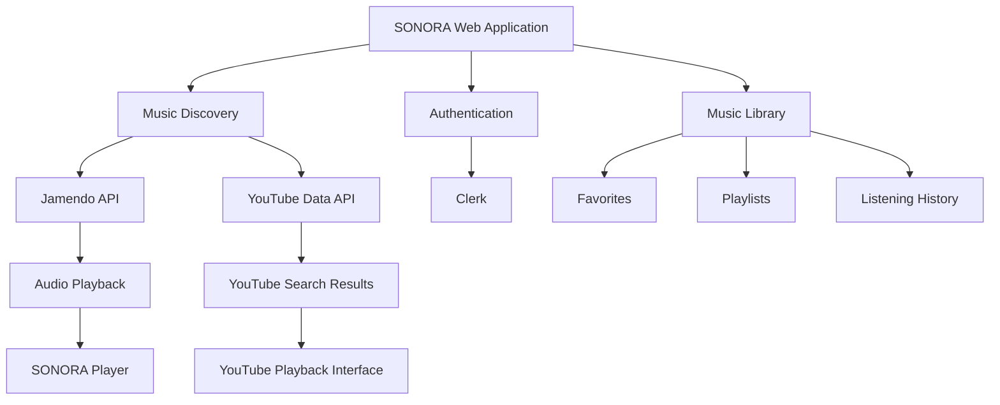

<div align="center">

# 🎧 S O N O R A

### YOUR SOUND. YOUR SPACE. YOUR UNIVERSE.

**An immersive music streaming experience where music meets design.**

<br/>

[](https://react.dev/)
[](https://www.typescriptlang.org/)
[](https://vite.dev/)
[](https://clerk.com/)
[](https://vercel.com/)

<br/>

## 🌐 SONORA IS LIVE!

[](https://sonora-two-psi.vercel.app)

### [🎵 CLICK HERE TO EXPERIENCE SONORA](https://sonora-two-psi.vercel.app)

**Discover. Listen. Feel. Repeat.**

<br/>

[](https://github.com/oishipaul45-engineer/sonora)
[](https://github.com/oishipaul45-engineer/sonora/issues)
[](https://sonora-two-psi.vercel.app)

</div>

---

## ✦ WELCOME TO SONORA

> **Music isn't just something you hear. It's something you feel.**

**SONORA** is a modern music streaming web application designed to make discovering and listening to music feel effortless, immersive, and personal.

Inspired by an **Electric Muse** aesthetic, SONORA combines expressive visual design, fluid animations, intuitive music controls, and multiple music discovery sources.

From finding your next favorite song to building playlists and exploring your listening history, SONORA brings music and creativity together.

<div align="center">

```text
╭────────────────────────────────────────────╮
│                                            │
│                S O N O R A                 │
│                                            │
│           YOUR MUSIC UNIVERSE              │
│                                            │
│        DISCOVER  •  PLAY  •  REPEAT        │
│                                            │
╰────────────────────────────────────────────╯
```

**[ENTER THE MUSIC UNIVERSE ↗](https://sonora-two-psi.vercel.app)**

</div>

---

## ✨ FEATURES

| Feature | Description |
|---|---|
| 🎵 Music Streaming | Discover and stream available music through Jamendo |
| 📺 YouTube Search | Search for music through YouTube integration |
| 🔎 Music Discovery | Explore tracks and find new favorites |
| ❤️ Favorites | Save tracks you love |
| 📚 Custom Playlists | Create and manage music collections |
| 🎧 Audio Player | Play, pause, skip, seek, and control volume |
| 📋 Up Next | Manage your upcoming music queue |
| 🕒 Listening History | Revisit previously played tracks |
| ✨ Recommendations | Explore suggested music |
| 🖥️ Fullscreen Player | Enjoy an immersive listening interface |
| 🔐 Authentication | Sign in and manage your account using Clerk |
| 💫 Animations | Experience smooth UI transitions with Framer Motion |
| 🎨 Custom Interface | A distinctive Electric Muse-inspired design |

---

## 🎨 THE ELECTRIC MUSE AESTHETIC

SONORA is designed to feel different from conventional music applications.

Rather than relying on a generic streaming dashboard, its interface embraces an expressive, editorial visual language.

### Visual Identity

- Warm cream-inspired backgrounds
- Electric lavender accents
- Bold typography
- Distinctive layouts
- Animated interactions
- Immersive playback controls
- Carefully designed interface details

**Signature Accent Color**

`#C2A0FF`

**Design Philosophy**

> A music player should feel as memorable as the music it plays.

---

## 🖥️ LIVE APPLICATION

SONORA is deployed on **Vercel** and accessible directly through your browser.

<div align="center">

### 🎧 EXPERIENCE IT YOURSELF

[](https://sonora-two-psi.vercel.app)

**Live URL:** https://sonora-two-psi.vercel.app

</div>

### What You Can Explore

1. Open the SONORA homepage.
2. Discover music through available tracks.
3. Search for your favorite artists or songs.
4. Explore YouTube music results.
5. Play music using the built-in player.
6. Save favorites and organize playlists.
7. Explore listening history and recommendations.
8. Sign in through Clerk authentication.

*Music availability and playback depend on the connected services and their permissions.*

---

## 🛠️ TECH STACK

<div align="center">

| Technology | Purpose |
|---|---|
| React | Frontend user interface |
| TypeScript | Type-safe application development |
| Vite | Development server and production bundling |
| CSS | Custom styling and visual design |
| Framer Motion | Animations and transitions |
| Lucide React | Interface icons |
| Clerk | Authentication |
| Jamendo API | Music discovery and streaming |
| YouTube Data API v3 | YouTube music search |
| GitHub | Version control and source hosting |
| Vercel | Deployment and web hosting |

</div>

---

## 🚀 GETTING STARTED

Want to run SONORA on your own computer?

Follow these steps.

### 01 — Clone the Repository

```bash
git clone https://github.com/oishipaul45-engineer/sonora.git
```

### 02 — Navigate to the Project

```bash
cd sonora
```

### 03 — Install Dependencies

```bash
npm install
```

### 04 — Configure Environment Variables

Create a `.env` file in the project root.

```env
VITE_CLERK_PUBLISHABLE_KEY=your_clerk_publishable_key

VITE_JAMENDO_CLIENT_ID=your_jamendo_client_id

VITE_YOUTUBE_API_KEY=your_youtube_api_key
```

Obtain the required credentials from:

- **Clerk:** https://dashboard.clerk.com
- **Jamendo:** https://developer.jamendo.com
- **Google Cloud:** https://console.cloud.google.com/apis/credentials

Enable **YouTube Data API v3** in your Google Cloud project.

For browser-based YouTube requests, configure HTTP referrer restrictions for your local and deployed domains.

**Security Note:** Vite environment variables prefixed with `VITE_` are exposed to browser JavaScript. Never place private server-side secrets in these variables. Apply appropriate API restrictions.

### 05 — Start the Development Server

```bash
npm run dev
```

Open the localhost URL shown in the terminal.

Typically:

```text
http://localhost:5173
```

### 06 — Build for Production

```bash
npm run build
```

### 07 — Preview the Production Build

```bash
npm run preview
```

---

## 🏗️ PROJECT STRUCTURE

A simplified overview of the SONORA frontend:

```text
sonora/
│
├── public/
│   └── Static assets
│
├── src/
│   ├── App.tsx
│   ├── App.css
│   ├── main.tsx
│   ├── jamendo.ts
│   ├── youtube.ts
│   └── Other frontend files
│
├── index.html
├── package.json
├── package-lock.json
├── tsconfig.json
├── vite.config.ts
└── README.md
```

### Key Files

**`App.tsx`**

Contains the primary SONORA interface, music player, navigation, and interactive features.

**`App.css`**

Defines the Electric Muse visual identity, layout, typography, and interface styling.

**`main.tsx`**

Initializes React and integrates Clerk authentication.

**`jamendo.ts`**

Handles communication with the Jamendo music API.

**`youtube.ts`**

Handles YouTube search requests.

---

## 🔐 AUTHENTICATION WITH CLERK

SONORA integrates Clerk authentication into its React application.

### Clerk Provider

```tsx
import { ClerkProvider } from "@clerk/react";

<ClerkProvider publishableKey={PUBLISHABLE_KEY}>
  <App />
</ClerkProvider>
```

### Sign-In and User Controls

```tsx
import {
  Show,
  SignInButton,
  UserButton,
} from "@clerk/react";

function AuthenticationControls() {
  return (
    <>
      <Show when="signed-out">
        <SignInButton mode="modal">
          <button type="button">
            Sign In
          </button>
        </SignInButton>
      </Show>

      <Show when="signed-in">
        <UserButton />
      </Show>
    </>
  );
}
```

Clerk provides authentication components and account-management functionality.

---

## 🎼 MUSIC DISCOVERY ARCHITECTURE



---

## ☁️ DEPLOYMENT ON VERCEL

SONORA is hosted on Vercel with its source code maintained on GitHub.

### Deployment Workflow

```text
Developer
    │
    ▼
GitHub Repository
    │
    ▼
Vercel Deployment
    │
    ▼
Vite Production Build
    │
    ▼
SONORA Live Website
```

### Deployment Configuration

| Setting | Value |
|---|---|
| Framework | Vite |
| Build Command | `npm run build` |
| Output Directory | `dist` |
| Install Command | `npm install` |
| Hosting | Vercel |

Environment variables are configured through the Vercel project dashboard.

Updates pushed to the connected production branch can trigger automatic redeployment.

**Live Deployment:** https://sonora-two-psi.vercel.app

---

## 🌌 FUTURE ROADMAP

Some ideas for SONORA's future development:

- [ ] Collaborative playlists
- [ ] Cross-device playlist synchronization
- [ ] Personalized music recommendations
- [ ] Advanced artist and genre filters
- [ ] Audio-reactive visualizations
- [ ] Enhanced listening analytics
- [ ] Keyboard shortcuts
- [ ] Accessibility improvements
- [ ] More music discovery integrations
- [ ] Mobile experience enhancements

*These are planned ideas and potential improvements, not a list of completed features.*

---

## 🤝 CONTRIBUTING

Contributions, suggestions, and improvements are welcome.

### How to Contribute

1. Fork the repository.
2. Create a feature branch.

```bash
git checkout -b feature/amazing-feature
```

3. Commit your changes.

```bash
git commit -m "Add amazing feature"
```

4. Push your branch.

```bash
git push origin feature/amazing-feature
```

5. Open a Pull Request.

For bug reports or feature suggestions, visit the [Issues page](https://github.com/oishipaul45-engineer/sonora/issues).

---

## 🔗 IMPORTANT LINKS

| Resource | Link |
|---|---|
| 🎧 Live SONORA App | [Launch Website](https://sonora-two-psi.vercel.app) |
| 💻 GitHub Repository | [View Source Code](https://github.com/oishipaul45-engineer/sonora) |
| 🐛 Issues | [Report a Bug](https://github.com/oishipaul45-engineer/sonora/issues) |
| 👩‍💻 Developer Profile | [Oishi Paul on GitHub](https://github.com/oishipaul45-engineer) |
| ⚛️ React | [Documentation](https://react.dev/) |
| 🔷 TypeScript | [Documentation](https://www.typescriptlang.org/) |
| ⚡ Vite | [Documentation](https://vite.dev/) |
| 🔐 Clerk | [Documentation](https://clerk.com/docs) |
| 🎵 Jamendo | [Developer Portal](https://developer.jamendo.com/) |
| 📺 YouTube API | [Documentation](https://developers.google.com/youtube/v3) |
| ▲ Vercel | [Platform](https://vercel.com/) |

---

## 👩‍💻 CREATED BY

<div align="center">

### OISHI PAUL

**Developer & Creator of SONORA**

*Building digital experiences where creativity meets technology.*

<br/>

[](https://github.com/oishipaul45-engineer)

[](https://sonora-two-psi.vercel.app)

<br/>

### ⭐ SUPPORT SONORA

If you enjoy the project, consider giving the repository a star!

[](https://github.com/oishipaul45-engineer/sonora)

<br/>

---

### 🎧 S O N O R A

**YOUR SOUND. YOUR SPACE. YOUR UNIVERSE.**

*Discover beyond the algorithm. Listen beyond the ordinary.*

**© 2026 SONORA**

</div>
