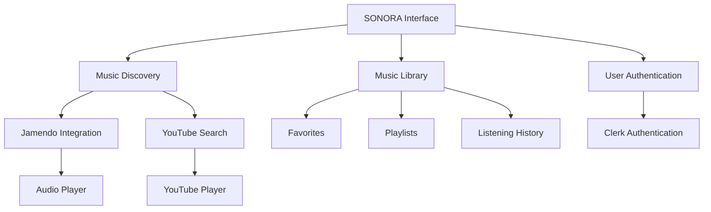

 
<div align="center">

# 🎧 SONORA

### YOUR SOUND. YOUR SPACE. YOUR UNIVERSE.

**An immersive music streaming experience, built for people who feel music differently.**

<br>

[](https://react.dev/)
[](https://www.typescriptlang.org/)
[](https://vite.dev/)
[](https://clerk.com/)
[](#-design-philosophy)

<br>

[**EXPLORE SOURCE CODE**](https://github.com/oishipaul45-engineer/sonora) · [**REPORT AN ISSUE**](https://github.com/oishipaul45-engineer/sonora/issues) · [**FEATURE REQUESTS**](https://github.com/oishipaul45-engineer/sonora/issues/new)

<br>

*Discover beyond the algorithm. Listen beyond the ordinary.*

</div>

---

## ✦ THE SONORA EXPERIENCE

SONORA is more than a conventional music player. It is an interactive music discovery environment that combines modern frontend engineering, expressive motion design, and seamless music exploration.

Built around an **Electric Muse** aesthetic, SONORA transforms the listening experience through atmospheric visuals, intuitive controls, and personalized music organization.

```text
╭──────────────────────────────────────────╮
│                                          │
│             S O N O R A                  │
│                                          │
│       THE ART OF FEELING MUSIC           │
│                                          │
│       DISCOVER  •  PLAY  •  REPEAT       │
│                                          │
╰──────────────────────────────────────────╯
```

## ✨ FEATURES THAT HIT DIFFERENT

| Feature | Experience |
|---|---|
| 🎵 Music Streaming | Explore and play available tracks through Jamendo integration |
| 📺 YouTube Discovery | Find YouTube music and access video playback |
| 🔍 Smart Search | Search and discover music across supported sources |
| ❤️ Favorites | Save tracks you love |
| 📚 Custom Playlists | Build and manage personal music collections |
| 🎛️ Playback Controls | Play, pause, skip, seek, and control volume |
| 📋 Up Next Queue | Organize upcoming tracks |
| 🕘 Listening History | Revisit previously played music |
| ✨ Recommendations | Discover more music through curated recommendations |
| 🖥️ Fullscreen Player | Enjoy an immersive playback interface |
| 🔐 Authentication | Sign in and sign up through Clerk |
| 💫 Motion Design | Smooth transitions and animated interactions |

---

## 🎨 DESIGN PHILOSOPHY

> Music is not just something you hear. It is something you experience.

SONORA's visual identity is inspired by **Electric Muse** — a creative direction that combines expressive typography, warm atmospheric surfaces, futuristic accents, and purposeful micro-interactions.

**Visual ingredients**

- Warm cream-inspired backgrounds
- Electric lavender accents
- Expressive layouts and bold typography
- Animated interface elements
- Immersive playback experiences
- A design language that feels artistic rather than generic

**Signature accent:** `#C2A0FF`

---

## 🧬 BUILT WITH

<div align="center">

| Layer | Technology | Purpose |
|---|---|---|
| Frontend | React | Interactive component architecture |
| Language | TypeScript | Type-safe application development |
| Build Tool | Vite | Fast development and production builds |
| Styling | CSS | Custom Electric Muse visual system |
| Animation | Framer Motion | Smooth interactive animations |
| Icons | Lucide React | Clean, consistent iconography |
| Authentication | Clerk | User authentication and account management |
| Music API | Jamendo | Music discovery and audio sources |
| Video Search | YouTube integration | YouTube music discovery |

</div>

---

## 🚀 RUN SONORA LOCALLY

### 01 — Clone the universe

```bash
git clone https://github.com/oishipaul45-engineer/sonora.git
```

### 02 — Enter the project

```bash
cd sonora
```

### 03 — Install dependencies

```bash
npm install
```

### 04 — Configure environment variables

Create a `.env` file in the project root.

```env
VITE_CLERK_PUBLISHABLE_KEY=your_clerk_publishable_key
```

If your Jamendo or YouTube integrations use additional environment variables, configure those using the names expected by your local source code.

Never commit private API credentials or secret keys.

### 05 — Start the experience

```bash
npm run dev
```

Open the local URL displayed by Vite, typically:

```text
http://localhost:5173
```

### 06 — Create a production build

```bash
npm run build
```

### 07 — Preview the build

```bash
npm run preview
```

---

## 🏗️ PROJECT ARCHITECTURE

A simplified view of the main application structure:

```text
sonora/
│
├── public/                  # Public assets
│
├── src/
│   ├── App.tsx              # Main application interface
│   ├── App.css              # Custom design system
│   ├── main.tsx             # React and Clerk initialization
│   ├── jamendo.ts           # Jamendo music integration
│   └── youtube.ts           # YouTube search integration
│
├── index.html
├── package.json
├── tsconfig.json
├── vite.config.ts
└── README.md
```

---

## 🔐 AUTHENTICATION

SONORA uses [Clerk](https://clerk.com/) for authentication.

The application integrates Clerk's React SDK with its main React component tree.

```tsx
import { ClerkProvider } from "@clerk/react";

<ClerkProvider publishableKey={PUBLISHABLE_KEY}>
  <App />
</ClerkProvider>
```

The user interface can conditionally display sign-in and account controls:

```tsx
import {
  Show,
  SignInButton,
  UserButton,
} from "@clerk/react";

<Show when="signed-out">
  <SignInButton mode="modal">
    <button>Sign in</button>
  </SignInButton>
</Show>

<Show when="signed-in">
  <UserButton />
</Show>
```

---

## 🎼 MUSIC MEETS ENGINEERING



---

## 🌌 WHAT'S NEXT?

Future possibilities for SONORA include:

- [ ] Cross-device playlist synchronization
- [ ] Enhanced personalized recommendations
- [ ] Collaborative playlists
- [ ] Advanced music discovery filters
- [ ] Audio-reactive visualizations
- [ ] Improved accessibility and keyboard navigation
- [ ] More listening insights

These are ideas for future development, not currently guaranteed features.

---

## 🔗 USEFUL LINKS

| Resource | Link |
|---|---|
| SONORA Repository | [GitHub](https://github.com/oishipaul45-engineer/sonora) |
| Issues & Feedback | [Open Issues](https://github.com/oishipaul45-engineer/sonora/issues) |
| React Documentation | [react.dev](https://react.dev/) |
| TypeScript Documentation | [typescriptlang.org](https://www.typescriptlang.org/) |
| Vite Documentation | [vite.dev](https://vite.dev/) |
| Clerk Documentation | [clerk.com/docs](https://clerk.com/docs) |
| Jamendo Developer Portal | [developer.jamendo.com](https://developer.jamendo.com/) |
| YouTube Data API | [Google Developers](https://developers.google.com/youtube/v3) |

---

## 👩‍💻 CREATED BY

<div align="center">

### OISHI PAUL

*Building digital experiences where design meets engineering.*

[](https://github.com/oishipaul45-engineer)

<br>

**If SONORA resonates with you, consider giving the repository a star!**

[⭐ STAR SONORA](https://github.com/oishipaul45-engineer/sonora)

<br>

### MADE FOR THE LOVE OF MUSIC.

**SONORA © 2026**

*Stay curious. Stay electric. Stay in tune.*

</div>
